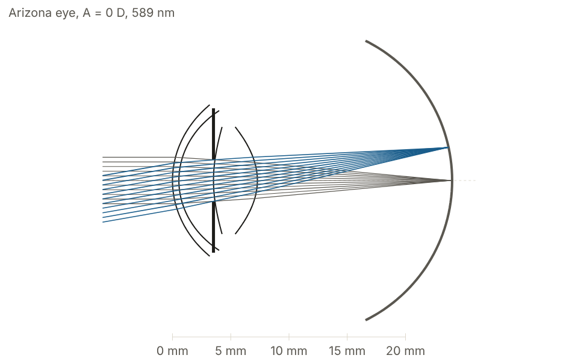
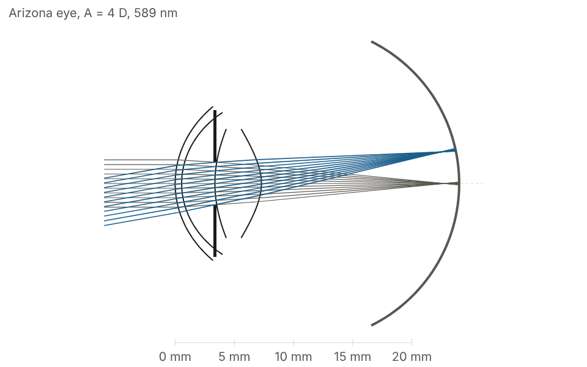

# Arizona eye

Four conic surfaces with dispersion, tuned to match average clinical levels of on- and off-axis
aberration, and adjustable for accommodation. Well suited to checking reflections from the cornea
and lens, and to designs that must perform like a real eye.

## Ray trace

*A = 0 D, 10° field, 589 nm.*

*A = 4 D, 10° field. The object is distant, so the rays focus in front of the retina.*

Drawn to scale by an exact ray tracer from the prescription below: 4 mm entrance pupil, grey rays on axis, blue rays at the field angle shown, light from the left.

## Prescription

A is the accommodation in dioptres (0 for a relaxed eye). Indices are nd; Abbe numbers are Vd.

| # | Surface | Radius (mm) | Conic K | Thickness to next (mm) | Medium after | nd | Vd |
|---|---|---|---|---|---|---|---|
| 1 | Cornea front | 7.8 | −0.25 | 0.55 | cornea | 1.377 | 57.1 |
| 2 | Cornea back | 6.5 | −0.25 | t_aq | aqueous | 1.337 | 61.3 |
| 3 | Lens front | R_ant | K_ant | t_lens | lens | n_lens | 51.9 |
| 4 | Lens back | R_post | K_post | 16.713 | vitreous | 1.336 | 61.1 |
| 5 | Retina | −13.4 | 0 | — | — | — | — |

Accommodation formulas:

| Parameter | Formula | At A = 0 |
|---|---|---|
| R_ant | 12.0 − 0.4A | 12.0 |
| K_ant | −7.518749 + 1.285720A | −7.518749 |
| R_post | −5.224557 + 0.2A | −5.224557 |
| K_post | −1.353971 − 0.431762A | −1.353971 |
| t_aq | 2.97 − 0.04A | 2.97 |
| t_lens | 3.767 + 0.04A | 3.767 |
| n_lens | 1.42 + 0.00256A − 0.00022A² | 1.42 |

The anterior chamber shrinks and the lens thickens by the same amount, so the axial length stays
the same as the eye accommodates.

## Where the stop goes

The iris sits at the front of the lens. Place the stop at the lens front surface and size it for
the pupil you need.

## Files

- [`data/arizona-eye-0D.csv`](../data/arizona-eye-0D.csv): the relaxed eye, A = 0.
- arizona-eye-0D: [Zemax `.zmx`](../formats/zemax/arizona-eye-0D.zmx), [CODE V `.seq`](../formats/codev/arizona-eye-0D.seq), [JSON](../formats/json/arizona-eye-0D.json)
- arizona-eye-2D: [Zemax `.zmx`](../formats/zemax/arizona-eye-2D.zmx), [CODE V `.seq`](../formats/codev/arizona-eye-2D.seq), [JSON](../formats/json/arizona-eye-2D.json)
- arizona-eye-4D: [Zemax `.zmx`](../formats/zemax/arizona-eye-4D.zmx), [CODE V `.seq`](../formats/codev/arizona-eye-4D.seq), [JSON](../formats/json/arizona-eye-4D.json)
- arizona-eye-6D: [Zemax `.zmx`](../formats/zemax/arizona-eye-6D.zmx), [CODE V `.seq`](../formats/codev/arizona-eye-6D.seq), [JSON](../formats/json/arizona-eye-6D.json)
- Python: every model is in [`python/everyeyemodel.py`](../python/everyeyemodel.py).

## Sources

- J. Schwiegerling, *Field Guide to Visual and Ophthalmic Optics* (SPIE Press, 2004), the published
  model.
- Values here as tabulated in J. Schwiegerling, "Schematic Eyes and Ametropia", OPTI course notes,
  Visual Optics Lab, University of Arizona
  ([PDF](https://wp.optics.arizona.edu/visualopticslab/wp-content/uploads/sites/52/2021/08/Class02_21-Schematic-Eyes-Ametropia.pdf)).
  Checked 2026-11-21.

---

*Written by AI (Claude, by Anthropic) at Dan Gray's direction, from the sources above. See
[How this was made](../README.md#how-this-was-made).*
