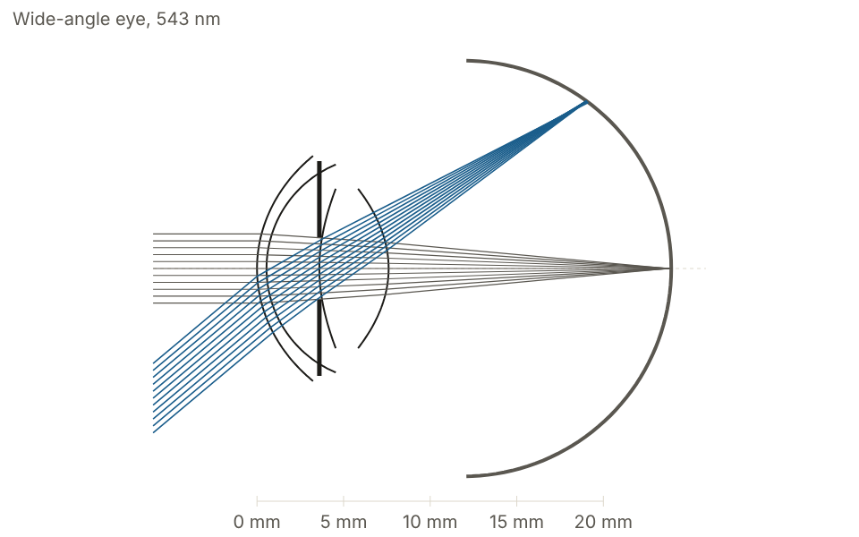

# Escudero-Sanz and Navarro wide-angle eye (1999)

Navarro's 1985 schematic eye turned into a wide-angle model by adding a curved retina. Four conic
surfaces, with indices given at four wavelengths. Built to reproduce the eye's off-axis aberrations
over a wide field, so it is the right choice when the field of view goes well past 45°.

## Ray trace

*40° field, 543 nm, landing on the curved retina.*

Drawn to scale by an exact ray tracer from the prescription below: 4 mm entrance pupil, grey rays on axis, blue rays at the field angle shown, light from the left.

## Prescription

| # | Surface | Radius (mm) | Conic K | Thickness to next (mm) | Medium after |
|---|---|---|---|---|---|
| 1 | Cornea front | 7.72 | −0.26 | 0.55 | cornea |
| 2 | Cornea back | 6.50 | 0 | 3.05 | aqueous |
| 3 | Lens front | 10.20 | −3.1316 | 4.00 | lens |
| 4 | Lens back | −6.00 | −1.0 | 16.3203 | vitreous |
| 5 | Retina | −12.00 | 0 | — | — |

Axial length: 23.9203 mm (sum of thicknesses).

## Refractive indices

| Medium | 458 nm | 543 nm | 589.3 nm | 632.8 nm |
|---|---|---|---|---|
| Cornea | 1.3828 | 1.3777 | 1.376 | 1.3747 |
| Aqueous | 1.3445 | 1.3391 | 1.3374 | 1.336 |
| Lens | 1.4292 | 1.4222 | 1.42 | 1.4183 |
| Vitreous | 1.3428 | 1.3377 | 1.336 | 1.3347 |

The model's design wavelength is 543 nm.

## Where the stop goes

The iris sits in the aqueous, just in front of the lens. Common implementations place it at the
lens front surface. Size it for the entrance pupil your study needs; the example below uses a
1.5 mm stop semi-diameter.

## Files

- [`data/escudero-sanz-navarro-wide-angle-eye.csv`](../data/escudero-sanz-navarro-wide-angle-eye.csv)
- escudero-sanz-navarro-wide-angle-eye: [Zemax `.zmx`](../formats/zemax/escudero-sanz-navarro-wide-angle-eye.zmx), [CODE V `.seq`](../formats/codev/escudero-sanz-navarro-wide-angle-eye.seq), [JSON](../formats/json/escudero-sanz-navarro-wide-angle-eye.json)
- Python: every model is in [`python/everyeyemodel.py`](../python/everyeyemodel.py).

## Sources

- I. Escudero-Sanz and R. Navarro, "Off-axis aberrations of a wide-angle schematic eye model",
  *J. Opt. Soc. Am. A* **16**(8), 1881–1891 (1999),
  [doi:10.1364/JOSAA.16.001881](https://doi.org/10.1364/JOSAA.16.001881).
- R. Navarro, J. Santamaría and J. Bescós, "Accommodation-dependent model of the human eye with
  aspherics", *J. Opt. Soc. Am. A* **2**(8), 1273–1281 (1985),
  [doi:10.1364/JOSAA.2.001273](https://doi.org/10.1364/JOSAA.2.001273), the eye it is built on.
- Values here as implemented in the ZOSPy example "Escudero-Sanz eye model"
  ([documentation](https://zospy.readthedocs.io/en/latest/examples/Escudero-Sanz%20eye%20model/Escudero-Sanz%20eye%20model.html)).
  Checked 2026-11-21.
- D. A. Atchison and G. Smith, *Optics of the Human Eye* (Butterworth-Heinemann, 2000), appendix A3,
  which tabulates the 1985 Navarro eye. Cross-checked 2026-11-24: radii, conics, the first three
  thicknesses, the retina radius and the 589.3 nm indices agree, and so does the power, 60.416 D.
  The vitreous differs by design: the 1999 model refocuses at 543 nm, and 16.3203 mm is the
  paraxial focus there. The indices at 458, 543 and 632.8 nm are not in that appendix and remain
  unchecked against the paper.

---

*Written by AI (Claude, by Anthropic) at Dan Gray's direction, from the sources above. See
[How this was made](../README.md#how-this-was-made).*
