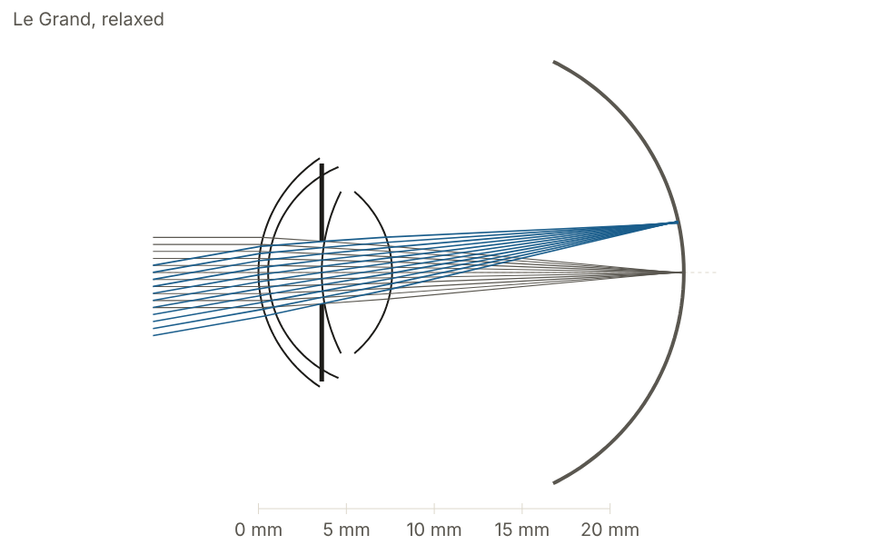
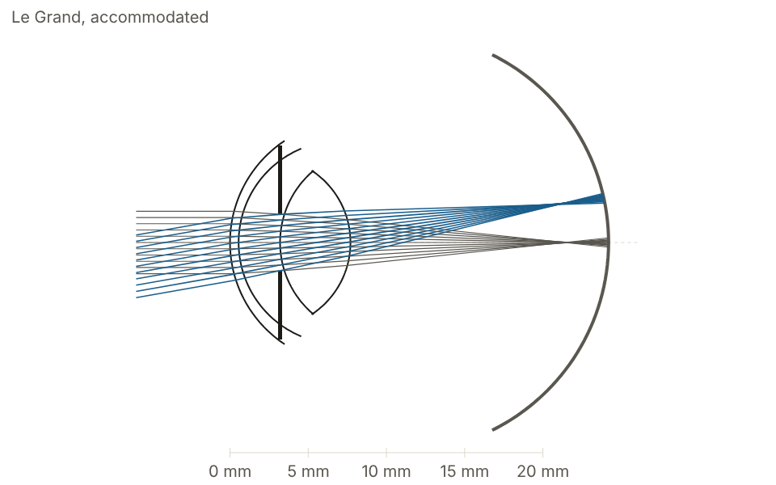

# Le Grand full theoretical eye

Four spherical surfaces: two for the cornea, two for the lens. A classic textbook eye for cardinal
points and first-order checks.

## Ray trace

*Relaxed, 10° field.*

*Accommodated, 10° field. The object is distant, so the rays focus in front of the retina.*

Drawn to scale by an exact ray tracer from the prescription below: 4 mm entrance pupil, grey rays on axis, blue rays at the field angle shown, light from the left.

## Relaxed

Indices as given in the source (single wavelength).

| # | Surface | Radius (mm) | Conic | Thickness to next (mm) | Index after |
|---|---|---|---|---|---|
| 1 | Cornea front | 7.8 | 0 | 0.55 | 1.3771 |
| 2 | Cornea back | 6.5 | 0 | 3.05 | 1.3374 (aqueous) |
| 3 | Lens front | 10.2 | 0 | 4.0 | 1.42 |
| 4 | Lens back | −6.0 | 0 | 16.59655 | 1.336 (vitreous) |
| 5 | Retina | −13.4 | 0 | — | — |

Checks from the same source: total power 59.94 D; image-space focal length 22.289 mm, measured from
the rear principal point, which sits 1.908 mm behind the cornea front; front focal point 15.089 mm
in front of the cornea. Axial length 24.19655 mm (sum of the thicknesses).

## Accommodated

As given in the same source, which titles it "Accommodated Gullstrand Model". Its cornea matches
the relaxed eye above, and its lens values are those of Le Grand's accommodated eye.

| # | Surface | Radius (mm) | Index after | Thickness to next (mm) |
|---|---|---|---|---|
| 1 | Cornea front | 7.8 | 1.3771 | 0.55 |
| 2 | Cornea back | 6.5 | 1.3374 | 2.65 |
| 3 | Lens front | 6.0 | 1.4270 | 4.50 |
| 4 | Lens back | −5.5 | 1.3360 | 16.497 |

The source gives no retina radius for the accommodated form; use the relaxed retina, −13.4 mm.

## Where the stop goes

The iris sits just in front of the lens. Place the stop at the lens front surface, or a short
distance in front of it, and size it for the pupil you need.

## Files

- [`data/le-grand-full-theoretical-eye.csv`](../data/le-grand-full-theoretical-eye.csv)
- [`data/le-grand-accommodated.csv`](../data/le-grand-accommodated.csv)
- le-grand-relaxed: [Zemax `.zmx`](../formats/zemax/le-grand-relaxed.zmx), [CODE V `.seq`](../formats/codev/le-grand-relaxed.seq), [JSON](../formats/json/le-grand-relaxed.json)
- le-grand-accommodated: [Zemax `.zmx`](../formats/zemax/le-grand-accommodated.zmx), [CODE V `.seq`](../formats/codev/le-grand-accommodated.seq), [JSON](../formats/json/le-grand-accommodated.json)
- Python: every model is in [`python/everyeyemodel.py`](../python/everyeyemodel.py).

## Sources

- Y. Le Grand and S. G. El Hage, *Physiological Optics* (Springer, 1980), the original full
  theoretical eye.
- Values here as tabulated in J. Schwiegerling, "Schematic Eyes and Ametropia", OPTI course notes,
  Visual Optics Lab, University of Arizona
  ([PDF](https://wp.optics.arizona.edu/visualopticslab/wp-content/uploads/sites/52/2021/08/Class02_21-Schematic-Eyes-Ametropia.pdf)),
  which labels the relaxed model "Gullstrand-LeGrand". Checked 2026-11-21.
